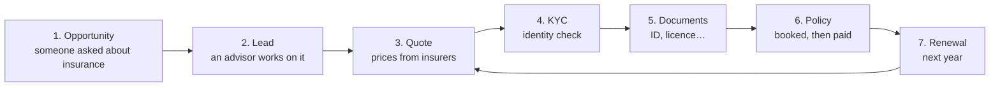
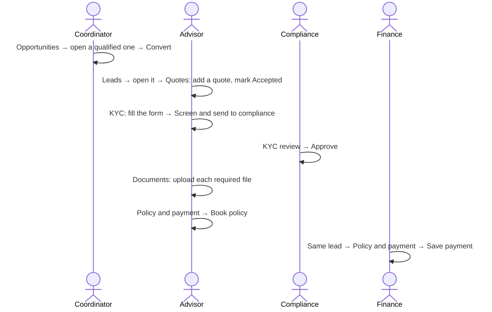

# Start here: a training guide

This page teaches you to use PolicyDesk in about 30 minutes. Read the words first, then do the practice run at the end with the demo accounts. You don't need to know any code.

## What PolicyDesk does

An insurance broker sells policies from many insurance companies (insurers). PolicyDesk keeps track of every customer from the first call to a paid policy, and reminds the team when the policy needs renewing a year later.

## Words you will see

| Word             | What it means                                                                                                  |
| ---------------- | -------------------------------------------------------------------------------------------------------------- |
| Opportunity      | A raw inquiry: a name, a phone number and the insurance they asked about. Nobody is selling to them yet.       |
| Qualified        | A coordinator called the customer and confirmed they really want insurance.                                    |
| Lead             | A qualified opportunity handed to an advisor. All the selling happens on the lead.                             |
| Reference        | A lead's code, such as `CAR-J2M3HX7`: the product's short code and seven random characters. Quote it on calls. |
| Product (LOB)    | The line of business: Car, Bike, Yacht, Health, Life, Savings, Home, Travel, Business, Cyber, Trade licence.   |
| Department       | The team that sells a product, e.g. Motor & Marine sells Car, Bike and Yacht.                                  |
| Insurer and plan | An insurance company and one of its products with a price, e.g. "Northwind Gold Comprehensive".                |
| Quote            | A plan and a price offered to the customer. The customer accepts or declines it.                               |
| KYC / AML        | "Know your customer" and anti-money-laundering: ID details are checked before a policy can be sold.            |
| Compliance       | The officer who approves or rejects KYC.                                                                       |
| Policy           | What the customer buys. It is **booked** first and becomes **active** when finance records the payment.        |
| Renewal          | A new lead created before an active policy ends, so the customer is insured for another year.                  |

### Product short codes

| Code | Product | Code | Product | Code | Product       |
| ---- | ------- | ---- | ------- | ---- | ------------- |
| CAR  | Car     | LIF  | Life    | BUS  | Business      |
| BIK  | Bike    | SAV  | Savings | CYB  | Cyber         |
| YCT  | Yacht   | HOM  | Home    | TLC  | Trade licence |
| HLT  | Health  | TRV  | Travel  |      |               |

A quote's reference adds its number on the lead: `CAR-J2M3HX7-Q2` is the second quote on lead `CAR-J2M3HX7`. You can search Leads, Policies and the Audit log by reference.

## Who does what

Each person signs in with a role. The role decides which menu items and buttons they see.

| Role               | Their daily job                                                            | Where they work         |
| ------------------ | -------------------------------------------------------------------------- | ----------------------- |
| Coordinator        | Calls new inquiries, marks them qualified or not, hands them to an advisor | Opportunities           |
| Advisor            | Sends quotes, collects KYC and documents, books the policy                 | Leads                   |
| Compliance officer | Approves or rejects KYC                                                    | KYC review              |
| Finance            | Records the payment, which makes the policy active                         | Policies, then the lead |
| Department manager | Sees the whole department, moves leads in bulk, reassigns advisors         | Dashboard, Leads        |
| Admin              | Sets up insurers, plans, required documents, users and roles               | Settings                |

## The screens

| Menu item         | What you do there                                                                              |
| ----------------- | ---------------------------------------------------------------------------------------------- |
| Dashboard         | Counts of your work, the pipeline, and policies to renew soon                                  |
| Opportunities     | New inquiries. Open one to qualify it, pick a coordinator, and convert it into a lead          |
| Leads             | Your leads. Tick several rows to move them to another stage at once                            |
| A lead's page     | A progress bar on top (Quote → KYC → Documents → Booked → Paid) and a tab for each step        |
| KYC review        | Compliance's queue: approve or reject, with a note                                             |
| Policies          | Every policy, its payment status, and a Renew button near the end date                         |
| Insurers & plans  | Admin: add insurers and their plans with prices                                                |
| Documents         | Admin: the list of document types, and which ones each product needs                           |
| Users, Roles      | Admin: who works here, their role and department, and what each role may do                    |
| Audit log         | Every change anyone made, newest first                                                         |
| Component library | For designers and developers: every button and field the app is built from, with live examples |
| Knowledge base    | These pages                                                                                    |

On a lead's page, the progress bar tells you what is missing. The tab that opens first is always the next unfinished step.

## Practice run (about 15 minutes)

Every demo account's password is `demo1234`, but you don't need it: the sign-in page has a button for each role. Use **Switch role** at the bottom of the sidebar to change person.

1. **Coordinator.** Open **Opportunities**, click the **Qualified** filter and open a customer. Under _Convert to lead_ pick the advisor **Aisha Khan** and press **Convert**. You land on the new lead. Note its reference, e.g. `CAR-J2M3HX7`.
2. **Advisor (Aisha Khan).** Open **Leads** and search for the reference or the name.
   - **Quotes** tab: pick a plan (the premium fills in), press **Add quote**, then **Accepted**.
   - **KYC** tab: type an ID number, pick a nationality, choose the dates in the calendars (click the month title to jump to a year), pick an occupation and source of funds, then **Screen and send to compliance**.
3. **Compliance officer.** Open **KYC review**, find the customer, write a short note and press **Approve**.
4. **Advisor again.** On the lead's **Documents** tab, pick each _required_ document type, drag a file onto the box (or click it) and press **Upload**. When every required one is in, open **Policy and payment** and press **Book policy**. A policy number like `PD-2026-00034` appears.
5. **Finance.** Open the same lead (or find it under **Policies**), type a payment reference and press **Save payment**. The policy turns **Active** and the progress bar is complete.
6. **Anyone.** Open **Audit log**, or the **Activity** panel on the lead, to see every step you just took.

### Things to try after that

- As **Department manager**, open **Leads**, tick two rows, and use **Move to stage** in the bar that rises at the bottom.
- As **Admin**, add a plan under **Insurers & plans**, then quote it on a lead.
- As **Admin**, make a document required for Car under **Documents**, and see it appear on a car lead.
- Switch the language to **العربية** in the sidebar: the whole app, including plan names, turns Arabic and right-to-left.
- Sign in as **Advisor** and try to open another advisor's lead: you get "not found", because advisors only see their own leads.

## When something blocks you

| You see                              | Why, and what to do                                                                   |
| ------------------------------------ | ------------------------------------------------------------------------------------- |
| "Not ready to book yet"              | The list under it says what is missing: an accepted quote, approved KYC or a document |
| No plans when adding a quote         | No active plan for this product. An admin adds one under Insurers & plans             |
| "You don't have access to this page" | Your role lacks the permission named in the message. An admin can add it under Roles  |
| A lead you expect is missing         | It belongs to another advisor or department. Ask your manager                         |
| KYC review needs a note              | High-risk or watchlist cases need enhanced due diligence notes before approving       |

## Next pages

- [Overview](/kb/overview) explains the business rules in more detail.
- [Roles and access](/kb/roles-and-access) explains permissions and who sees what.
- [Workflows](/kb/workflows) has the exact stages and the KYC scoring.
- The rest of the knowledge base is for developers: data model, architecture, UI library, translations and tests.
