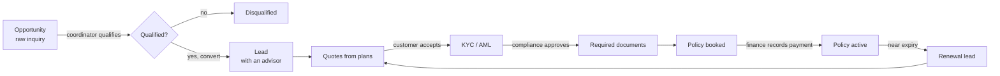

# Overview

PolicyDesk is a CRM for an insurance brokerage. It follows a customer from the first inquiry to a paid policy and its yearly renewal. Each person sees only what their role allows.

## The journey

## Main ideas

- **Opportunity first, then lead.** An opportunity is a raw inquiry. A coordinator qualifies it and converts it into a lead for an advisor in the right department.
- **Departments.** Every product belongs to one department. Most people only see their own department's work.
- **Plans catalogue.** Admins load plans from insurers. Advisors quote from active plans of the lead's product.
- **Compliance gate.** A policy can only be booked after the quote is accepted, compliance approves KYC, and every required document is uploaded.
- **Payments.** A new policy is _booked_. It becomes _active_ once finance records the payment.
- **Renewals.** An active policy near its end date can be renewed into a new renewal lead. Valid KYC carries over.
- **Audit trail.** Every change is logged. Each lead shows its own activity.

## Products and departments

| Department     | Products                             |
| -------------- | ------------------------------------ |
| Motor & Marine | Car, Bike, Yacht                     |
| Health         | Health                               |
| Life & Savings | Life, Savings                        |
| Home & Travel  | Home, Travel                         |
| Business       | Business (SME), Cyber, Trade licence |

Products, departments and covers are defined in `constants/products.ts`. Their labels are in `messages/`.
