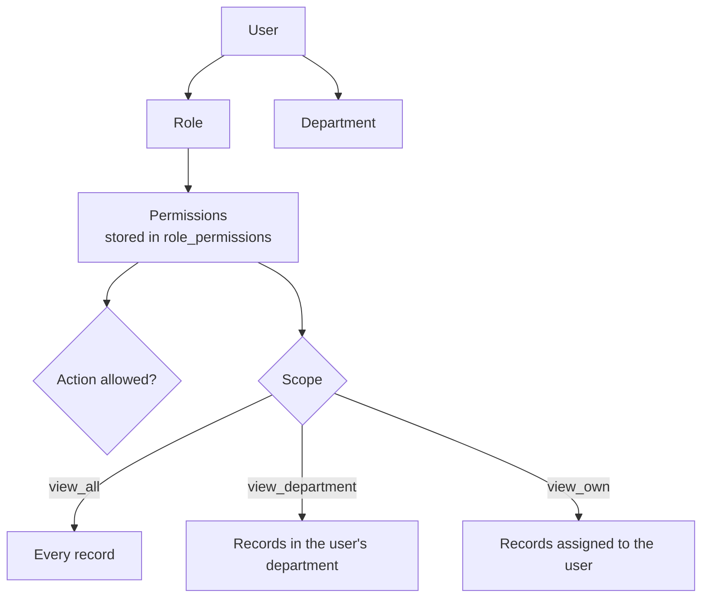

# Roles and access

Access is controlled in two layers. **Permissions** decide what someone can do. **Scope** decides whose records they can see.

## Permissions

- The list of permissions is fixed in code (`constants/permissions.ts`).
- Roles and the permissions they grant live in the database. Admins edit them under **Roles**.
- Permissions are read on every request, so a change applies on the user's next click.
- The **Admin** role is locked, so nobody can remove the last way back in.

## Scope

Opportunities and leads each have three view permissions. The widest one the user has wins.

| Permission          | Sees                                                     |
| ------------------- | -------------------------------------------------------- |
| `*:view_all`        | Every record                                             |
| `*:view_department` | Records of the user's department                         |
| `*:view_own`        | Opportunities they coordinate, or leads assigned to them |

Quotes, KYC, documents and policies follow their lead's scope. A record outside the scope returns **404**, so users can't even confirm that it exists. Lead links use a random UUID rather than the row number, so they can't be guessed either.

## Demo roles

| Role               | Typical work                                                            |
| ------------------ | ----------------------------------------------------------------------- |
| Admin              | Everything: plans, document settings, users, roles, audit               |
| Department manager | All opportunities and leads in one department; approves, books, cancels |
| Coordinator        | Qualifies opportunities and converts them into leads for advisors       |
| Advisor            | Own leads only: quotes, KYC, documents, booking, renewals               |
| Compliance officer | Reviews KYC / AML screening; reads any lead                             |
| Finance            | Records payments, which activates booked policies                       |
| Viewer             | Read-only                                                               |

## Where it is enforced

- **UI:** `can(user, permission)` hides links and buttons. This is only for a clean screen.
- **Server actions:** `requirePermission` and the guards in `server/guards.ts`. This is the real check.
- **Queries:** `opportunityScope` and `leadScope` in `server/queries/scope.ts` filter every read.
