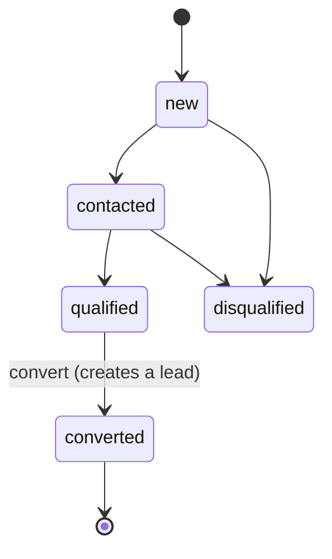
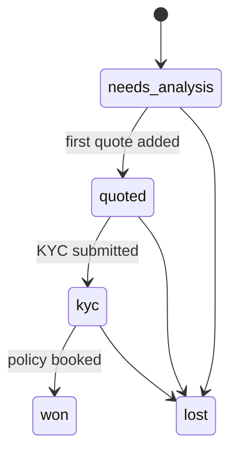
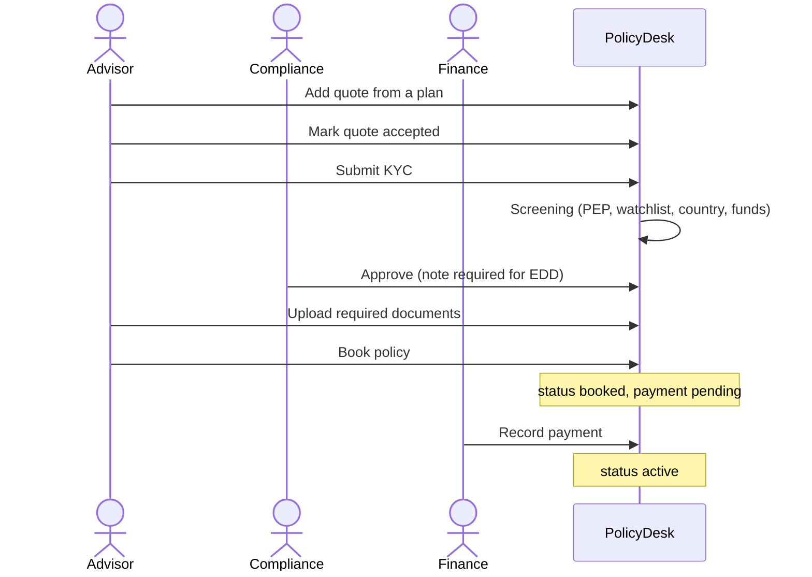

# Workflows

## Opportunity to lead

A coordinator, or anyone with `opportunities:convert`, converts a **qualified** opportunity. They pick an advisor from the same department. Converting creates the lead and an empty KYC record.

## Lead stages

Stages move forward on their own when work happens. Users can also set a stage by hand, but **won** is only set by booking a policy.

## Booking a policy

The server refuses to book until all three gates pass: an **accepted quote**, **approved KYC** and **every required document**.

## KYC / AML screening

Screening is simulated (`lib/kyc.ts`). It scores:

| Signal                                     | Points |
| ------------------------------------------ | ------ |
| Name on the watchlist                      | 3      |
| Politically exposed person (by occupation) | 2      |
| High-risk country                          | 3      |
| Source of funds is cash                    | 1      |
| Highest premium above the threshold        | 1      |

A score of 0 means low risk, 1–2 medium, 3 or more high. **Enhanced due diligence** is required for high risk, a watchlist match, or an expired ID. Compliance must write a note for EDD cases and for rejections. Under the four-eyes rule, the person who submitted a KYC cannot review it.

## Payments

| Recorded | Policy becomes |
| -------- | -------------- |
| Paid     | Active         |
| Failed   | Stays booked   |
| Refunded | Cancelled      |

## Renewals

An active policy can be renewed (the list highlights those ending within the renewal window). Renewing:

1. Creates a **renewal lead** on the same opportunity, linked to the old policy.
2. Keeps the same advisor while they are active.
3. Copies KYC. It stays **approved** only if the ID is valid past the old policy's end date. Otherwise it must be collected again.
4. Starts with no documents. They are collected again for the new term.
