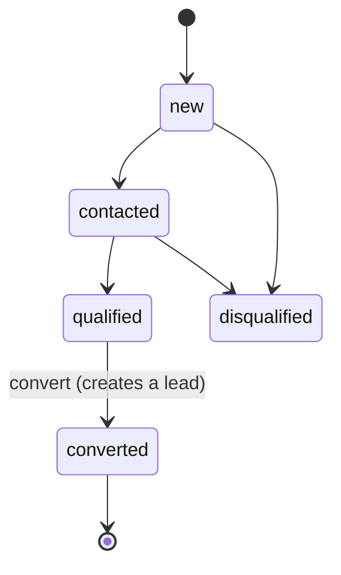
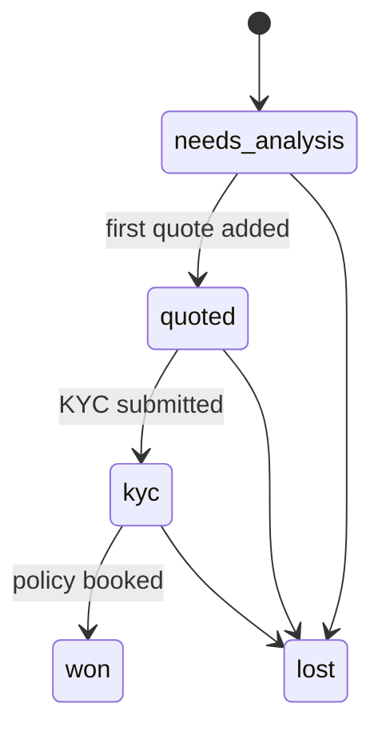
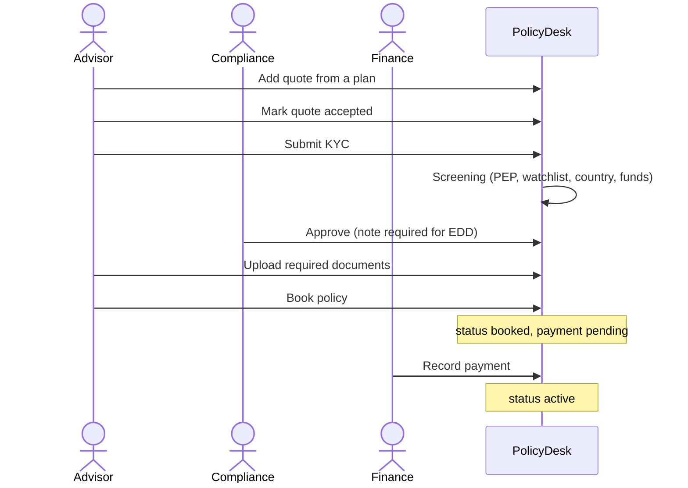

# Workflows

## Opportunity to lead

A coordinator, or anyone with `opportunities:convert`, converts a **qualified** opportunity. They pick an advisor from the same department. Converting creates the lead and an empty KYC record.

## Lead stages

Stages move forward on their own when work happens. Users can also set a stage by hand, but **won** is only set by booking a policy.

## Booking a policy

The server refuses to book until all three gates pass: an **accepted quote**, **approved KYC** and **every required document**.

## KYC / AML screening

Screening is simulated (`lib/kyc.ts`). It scores:

| Signal                                     | Points |
| ------------------------------------------ | ------ |
| Name on the watchlist                      | 3      |
| Politically exposed person (by occupation) | 2      |
| High-risk country                          | 3      |
| Source of funds is cash                    | 1      |
| Highest premium above the threshold        | 1      |

A score of 0 means low risk, 1–2 medium, 3 or more high. **Enhanced due diligence** is required for high risk, a watchlist match, or an expired ID. Compliance must write a note for EDD cases and for rejections. Under the four-eyes rule, the person who submitted a KYC cannot review it.

## Payments

| Recorded | Policy becomes |
| -------- | -------------- |
| Paid     | Active         |
| Failed   | Stays booked   |
| Refunded | Cancelled      |

## Renewals

An active policy can be renewed (the list highlights those ending within the renewal window). Renewing:

1. Creates a **renewal lead** on the same opportunity, linked to the old policy.
2. Keeps the same advisor while they are active.
3. Copies KYC. It stays **approved** only if the ID is valid past the old policy's end date. Otherwise it must be collected again.
4. Starts with no documents. They are collected again for the new term.

## The dashboard

The dashboard opens with **Needs you today**: up to four cards, each a count with a link to the list it counts.

| Card                 | Who sees it                      | What it counts                                                    | Opens                   |
| -------------------- | -------------------------------- | ----------------------------------------------------------------- | ----------------------- |
| KYC checks waiting   | KYC reviewers                    | Submitted KYC checks, with how long the oldest has waited         | KYC review              |
| KYC to send          | Advisors (no review permission)  | Their leads at the KYC stage whose KYC is not yet submitted       | Leads at KYC            |
| Payments to record   | Finance, managers, admins        | Booked policies waiting for payment, with the total               | Policies, Booked        |
| Paid online, to book | Advisors (no payment permission) | Leads paid on the website that have no policy yet, with the total | Leads, Paid online only |
| Leads to assign      | People who assign leads          | Open leads with no advisor                                        | Leads, No advisor       |
| Leads to quote       | Advisors (no assign permission)  | Their leads at Needs analysis                                     | Leads at Needs analysis |
| Renewals coming up   | Everyone who sees policies       | Active policies due for renewal in the next 45 days               | Policies, Renewal due   |

Website payments are recorded by PaySandbox itself (the policy is booked as paid), so there is no "online payment to record" for finance; the finance card counts booked policies waiting for a payment instead.

Below the cards a switch picks **This month**, **Quarter** or **Year** (`?period=`, in the Asia/Karachi time zone). Four numbers follow:

- **Premium written:** premium of policies booked in the period (not cancelled), with the change against the same point of the previous period ("+12% vs same point in October").
- **Open leads:** leads not won or lost, and how many arrived in the period.
- **Win rate:** won out of leads closed in the period, shown as "10 won of 12 closed". Under 5 closed leads it says "Not enough data yet". A lead has no closing date, so its last update counts as the day it closed.
- **Active policies:** and how many booked policies wait for payment.

Then the lead pipeline (neutral bars, Won in green, Lost in red), where the period's opportunities came from with how many became leads, and the renewals table with insurer, premium, advisor, end date with "in N days", and a Renew button. Every number follows the user's scope: an advisor sees only their own work.
