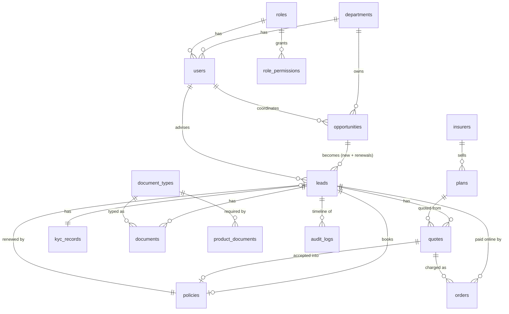

# Data model

The tables are defined in `server/db/schema.ts` (Drizzle). Production uses Neon Postgres. Locally the app runs on PGlite, a Postgres inside Node, so no install is needed.



## Notes

- **Lead identifiers:** every lead has three. `id` is the internal number used by forms and foreign keys. `public_id` is a UUID used in every link (`/leads/3f9c2a1e-…`), so a URL can't be guessed by changing a number. `reference` is what people read and say: the product's short code and 7 random characters from an alphabet without 0, O, 1, I or L, e.g. `CAR-J2M3HX7`. Quotes get the lead's reference plus their number on it, e.g. `CAR-J2M3HX7-Q2`. A renewal is a new lead, so it gets a new reference. Short codes live in `PRODUCT_CODES` (`constants/products.ts`); the generator is `lib/reference.ts`.
- **Opportunity identifiers:** opportunities also have a `public_id` UUID. The website API only ever sees that one. `details` holds the website form's product-specific answers (car make, model, year…) as `jsonb`, checked by `schemas/website.ts`.
- **Automatic assignment:** `users.available` (switched on the Users page) and `users.last_assigned_at` drive how website opportunities pick a coordinator; `users.phone` is shown on the website's coordinator card. See [Website and online payments](/kb/website-and-online-payments).
- **Snapshots:** a quote copies the insurer name, plan name and cover from the plan. Old quotes stay correct after a plan changes.
- **Multi-language data:** `document_types.name`, `document_types.description` and `plans.name` are `jsonb` of the shape `{ en, ar }`. Read them with `localized(value, locale)`.
- **Keys, not labels:** departments, products, covers and statuses are stored as keys. Labels come from `messages/`.
- **Files:** documents are stored base64 in Postgres, up to 2 MB each. This keeps the demo free of extra services. A production system would move them to object storage.
- **Online payments:** `orders` holds one row per PaySandbox checkout session for a website lead: status (`pending`, `paid`, `expired`), amount in whole dollars, the line items sent, and the PaySandbox session and payment ids. `webhook_events` keeps every PaySandbox webhook id already handled, so a replay changes nothing. See [Website and online payments](/kb/website-and-online-payments).
- **Audit:** `audit_logs.lead_id` links every lead-related event to its lead's timeline.

## Changing the schema

```bash
npm run db:generate          # write a migration from schema.ts
npm run db:setup -- --reset  # local: rebuild tables and demo data
```
