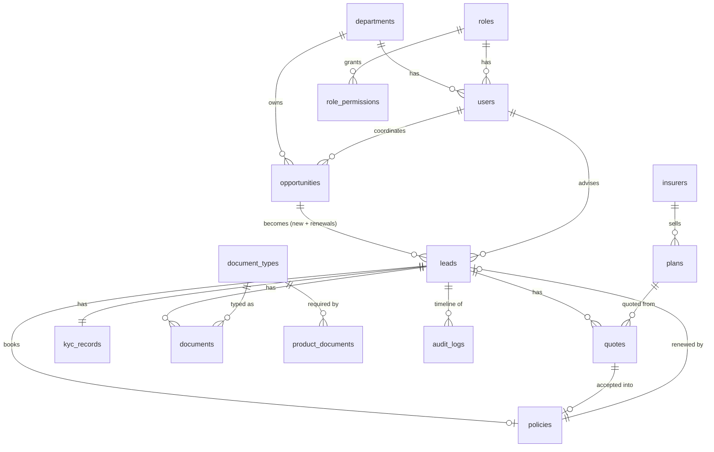

# Data model

The tables are defined in `server/db/schema.ts` (Drizzle). Production uses Neon Postgres. Locally the app runs on PGlite, a Postgres inside Node, so no install is needed.



## Notes

- **Snapshots:** a quote copies the insurer name, plan name and cover from the plan. Old quotes stay correct after a plan changes.
- **Multi-language data:** `document_types.name`, `document_types.description` and `plans.name` are `jsonb` of the shape `{ en, ar }`. Read them with `localized(value, locale)`.
- **Keys, not labels:** departments, products, covers and statuses are stored as keys. Labels come from `messages/`.
- **Files:** documents are stored base64 in Postgres, up to 2 MB each. This keeps the demo free of extra services. A production system would move them to object storage.
- **Audit:** `audit_logs.lead_id` links every lead-related event to its lead's timeline.

## Changing the schema

```bash
npm run db:generate          # write a migration from schema.ts
npm run db:setup -- --reset  # local: rebuild tables and demo data
```
