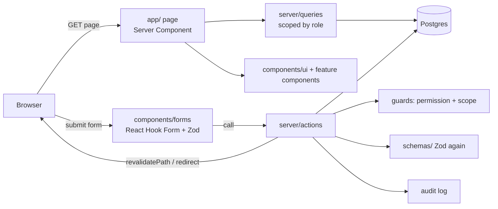

# Architecture

Next.js 15 App Router with Server Components, Server Actions, Drizzle ORM, Tailwind CSS 4, next-intl, React Hook Form and Zod.

## How a request flows

## Folders

| Folder                  | Role                                                      |
| ----------------------- | --------------------------------------------------------- |
| `app/`                  | Routes only                                               |
| `components/ui/`        | The UI library (see Component library in the app)         |
| `components/forms/`     | Client forms                                              |
| `components/<feature>/` | Feature sections, e.g. the lead tabs                      |
| `constants/`            | Statuses, products, permissions, navigation, config, i18n |
| `schemas/`              | Zod schemas shared by forms and actions                   |
| `server/actions/`       | Server actions per feature                                |
| `server/queries/`       | Reads per feature, plus row-level scope                   |
| `server/db/`            | Drizzle schema and client                                 |
| `lib/`                  | Pure helpers                                              |
| `messages/`             | Translations                                              |
| `docs/`                 | This knowledge base                                       |

## Lead page data

The lead page and each of its tabs call cached loaders in `server/queries/lead-details.ts`. React `cache()` makes each query run once per request. Tabs fetch their own data, nothing is passed down as props, and only the open tab's data is loaded.

## Sessions

The session is a signed JWT (`jose`) in an http-only cookie. `middleware.ts` only redirects signed-out visitors. The real check is `requireUser()`, which reads the user and their permissions from the database on every request.
