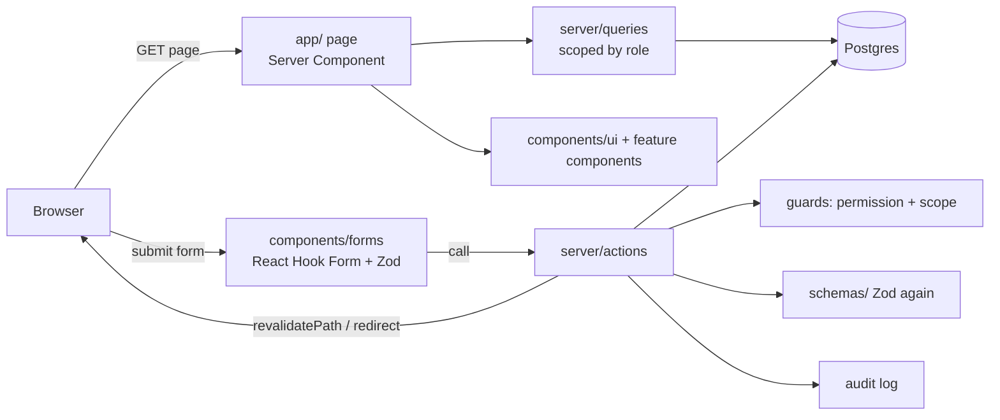

# Architecture

Next.js 15 App Router with Server Components, Server Actions, Drizzle ORM, Tailwind CSS 4, next-intl, React Hook Form and Zod.

## How a request flows

## Folders

| Folder                  | Role                                                      |
| ----------------------- | --------------------------------------------------------- |
| `app/`                  | Routes only                                               |
| `components/ui/`        | The UI library (see Component library in the app)         |
| `components/forms/`     | Client forms                                              |
| `components/<feature>/` | Feature sections, e.g. the lead tabs                      |
| `constants/`            | Statuses, products, permissions, navigation, config, i18n |
| `schemas/`              | Zod schemas shared by forms and actions                   |
| `server/actions/`       | Server actions per feature                                |
| `server/queries/`       | Reads per feature, plus row-level scope                   |
| `server/db/`            | Drizzle schema and client                                 |
| `lib/`                  | Pure helpers                                              |
| `messages/`             | Translations                                              |
| `docs/`                 | This knowledge base                                       |

## Lead page data

The lead page and each of its tabs call cached loaders in `server/queries/lead-details.ts`. React `cache()` makes each query run once per request. Tabs fetch their own data, nothing is passed down as props, and only the open tab's data is loaded.

## Sessions

The session is a signed JWT (`jose`) in an http-only cookie. `middleware.ts` only redirects signed-out visitors. The real check is `requireUser()`, which reads the user and their permissions from the database on every request.

## Login protection and monitoring

- **Password guessing is cut off.** After 10 failed sign-ins from one address in 15 minutes, that address is refused
  (`errors.tooManyAttempts`) before the database or bcrypt is touched, even with the right password, until the window
  passes. Counts live in memory (`server/login-guard.ts`), so an attack writes nothing to our database. Accounts are
  not locked, so nobody can lock a real user out on purpose. The form keeps one message for unknown email, inactive
  user and wrong password, so it doesn't reveal which emails exist.
- **Every login is reported to Pulse** (`server/pulse.ts`, my monitor): failures with a reason (`unknown_account`,
  `inactive`, `wrong_password`), successes, and blocks. Only the first 10 failures per address and window plus one
  "blocked" event are sent, so an attack of any size costs Pulse about 11 rows. Pulse stores the email and IP only as
  keyed hashes and flags brute force, password spraying and a sign-in right after many failures. Sent after the
  response with a 10-second limit nobody waits for (2 seconds silently dropped events when Pulse or its database was
  cold); a lost event leaves a one-line `[pulse]` warning in the Vercel logs. Off until `MONITOR_LOG_TOKEN` is set.

## App settings

App-wide switches live in the `app_settings` table, one row per setting with a JSON value (first one: `demo_mode`).
No screen or action writes them: they are changed only in the database's SQL editor, behind the owner's Vercel login,
so no PolicyDesk account can flip them. `lib/settings.ts` lists every known key with its type and default;
`getSetting()` reads them once per request and falls back to the default when a row is missing or malformed.
Migrations and missing settings are applied on every production deploy (`npm run db:migrate`, see `vercel.json`).
