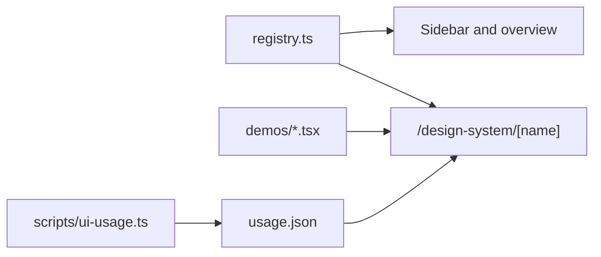

# UI and design system

The app is built only from our own UI library in `components/ui/`. The **Component library** (`/design-system`) works like a documentation site: a sidebar with every component grouped into 13 categories and a search box, an overview with the tokens, and one page per component (`/design-system/Button`) with named demos, a preview width switch (full, tablet, mobile), the code, the props, the keyboard keys and the files that use it.

## Categories

| Category   | Components                                                                             |
| ---------- | -------------------------------------------------------------------------------------- |
| Buttons    | Button, ButtonLink                                                                     |
| Forms      | Field, InlineForm, FormError, Hidden                                                   |
| Inputs     | Input, PasswordInput, NumberInput, PhoneInput, OtpInput, Textarea, FileUpload          |
| Selection  | Autocomplete, MultiSelect, Checkbox, Radio, RadioGroup, Switch, SegmentGroup, Rating   |
| Dates      | DatePicker                                                                             |
| Overlays   | Dialog (and side sheet), AlertDialog, Popover, Tooltip                                 |
| Menus      | DropdownMenu (icons, shortcuts, checks, submenus), ActionBar                           |
| Navigation | Tabs, PillNav                                                                          |
| Feedback   | Alert, Toast, EmptyState, Skeleton, Spinner, Progress, Forbidden                       |
| Layout     | PageHeader, Panel, PanelSection, DetailList                                            |
| Data       | DataTable (with row selection), TableFilters, CellText, ListRow, Badge, Stat, Timeline |
| Media      | Avatar, AvatarGroup, Icon                                                              |
| Effects    | MotionHighlight, NumberTicker, SpotlightCard, ShimmerText                              |

## Where the app uses them

- **Leads list:** stage tabs with counts, a Premium column, Advisor (a red "No advisor" badge when nobody works it), filters for advisor, department and "Paid online only", and rows that open the lead. Tick rows and the ActionBar rises with "Move to stage" and "Assign advisor". On phones each lead is a stacked card.
- **Opportunities and Policies lists:** the same counted tabs, row links and phone cards. Policies mark renewals with a "Due soon" badge next to the end date.
- **Lead page:** KYC dates use DatePicker, documents use the FileUpload drop zone, the activity trail is a Timeline, and cancelling a policy or deleting a document asks first with AlertDialog.
- **Dashboard:** "Needs you today" cards (Stat with badge and action), a period switch (PillNav `segment`), four KPIs with a comparison or hint line, the lead pipeline and sources as Funnel bars (Progress tones), and the renewals table. Numbers count up with NumberTicker. **Sidebar and pill filters:** MotionHighlight glides to the hovered link.
- **Users:** avatars, and deactivating asks first. **Login:** PasswordInput. **Quotes and plans:** NumberInput for premiums.
- **Every form** shows a toast when it saves, and list pages and the lead page show a Skeleton while they load.

## Tokens

All colours and fonts are tokens in `app/globals.css` under `@theme`.

| Token                                      | Use                           |
| ------------------------------------------ | ----------------------------- |
| `ink`                                      | Text, sidebar, active states  |
| `ink-soft`, `muted`                        | Secondary and tertiary text   |
| `paper`                                    | Page background, subtle fills |
| `line`                                     | Borders and dividers          |
| `brand` (+ `brand-strong`, `brand-soft`)   | Primary actions, done states  |
| `info`, `warn`, `risk`, `plum` (+ `-soft`) | Status colours                |

Fonts: Hanken Grotesk for Latin script, IBM Plex Sans Arabic for Arabic, IBM Plex Mono for policy numbers and code.

## Rules that keep it consistent

- Use only library components outside `components/ui`. ESLint blocks raw controls, inline styles and outside UI libraries.
- Give a component a new variant instead of overriding its classes.
- Put shared class recipes in `components/ui/styles.ts`.
- Every component has `data-ui="Name"` on its root. Inspect any element in the browser to see which component it is.
- `components/ui/registry.ts` describes every component for people and AI. `components/ui/usage.json`, generated by `npm run ui:usage`, lists where each one is used, so you can see the impact of a change before you make it.

## Building blocks

- **PageHeader** opens every page. **Panel** groups content, with `flush` for tables, lists and tabs, and `footer` for an add form. **PanelSection** is a padded block inside a flush panel.
- **DataTable** is every list. Give it columns; it adds search (`?q=`), filters (`?filter=`), pagination (`?page=`) and an EmptyState. Queries return `{ rows, total }` with `pageFrom(params)`. Optional props:
  - `filters.variant: "tabs"` shows the filter as underlined tabs; give each option a `count` and `filters.total` for All.
  - `refine: { selects, toggles }` adds dropdown and on/off filters beside the search, each its own URL parameter (`?advisor=`, `?paid=1`). They apply at once (TableFilters).
  - `rowHref` makes the whole row a link. Keep a real link in the row (CellText `href`) for the keyboard; the row-wide one is hidden from screen readers. Buttons and checkboxes in the row still work.
  - Column `priority: 2 | 3` hides a column while the table is narrower than 56rem / 64rem (container queries), so a laptop never scrolls sideways. Column `numeric` end-aligns amounts with tabular figures.
  - `mobile="rows"` with `summary(row) => { title, amount, meta, badges, date }` shows each row as a stacked ListRow card while the table is narrower than 42rem (phones).
- **Stat** takes `hint`, `delta: { value, label }` (green up, red down), `badge` and `action` (link text when `href` is set). **ListRow** takes `href`. **Progress** takes `tone` (`brand`, `neutral`, `risk`, `info`). **PillNav** takes `variant="segment"`.
- **EmptyState** always says what is missing and what to do next, with an icon and an optional action.

## Form controls

- `Autocomplete` is the only dropdown in the app. Type to filter, use the arrow keys to move, Enter to pick and Esc to close. It supports groups (for example, products by department) and a hint line per option.
- Option lists come from `lib/options.ts` (`productOptions`, `coverOptions`, `keyedOptions`, `plainOptions`), so every form shows the same labels.
- In React Hook Form use `FormAutocomplete`. In one-click server-action forms pass `name` and `defaultValue`.
- `Checkbox` and `Radio` are custom-drawn with brand colours and keep native keyboard and screen-reader behaviour.
- `PhoneInput` combines a searchable country code with the number and stores E.164 (`+971501234567`). `lockCountry` fixes the country.
- Validation rules live once in `schemas/fields.ts`: `email`, `phone`, `firstName`, `lastName`, `fullName`, `requiredText`, `optionalText`, `amount`, `date`, `option`. The Field preview on the Component library page runs them live.
- Every empty field shows a placeholder from `messages` (`placeholders.*`).

## Motion

Motion tokens live in `app/globals.css` (`animate-fade-in`, `scale-in`, `slide-up`, `slide-in-end`, `shimmer`). Overlays animate in when they open; effects are used once per screen at most. Everything respects reduced motion.

Effects are the only code that sets CSS variables from JavaScript (never a `style` attribute), for positions that classes can't know in advance.

## Testing components

`e2e/04-ui-library.spec.ts` opens every component's page and checks its demos render. It also tests Autocomplete, MultiSelect, Checkbox, DataTable with the ActionBar, DropdownMenu submenus, Dialog, DatePicker, Toast, PhoneInput and the shared validation rules. `e2e/05-bulk-actions.spec.ts` moves leads in bulk. `e2e/12-lists.spec.ts` covers counted tabs, filters, row links, bulk assign, phone rows and the Policies width; `e2e/13-dashboard.spec.ts` covers the task cards, the period switch and what an advisor sees. Add a test when you add a component with behaviour.

## Adding a component

1. Create `components/ui/<name>.tsx` with one exported component and `data-ui`.
2. Export it from `components/ui/index.ts`.
3. Add it to `registry.ts` with its category and keyboard keys.
4. Add named demos to its category file in `components/design-system/demos/`.
5. Run `npm run ui:usage`.

`npm run check` fails if a component file is missing from the registry or if `usage.json` is out of date.

## Responsive and RTL

- Write mobile-first: base classes are for phones, and `sm:`, `md:` and `lg:` add larger layouts.
- Every text container in a flex or grid gets `min-w-0`, and long text truncates or wraps.
- Tables scroll sideways below their minimum width.
- Use logical classes (`ms-`, `pe-`, `text-start`), so Arabic mirrors the layout automatically.
