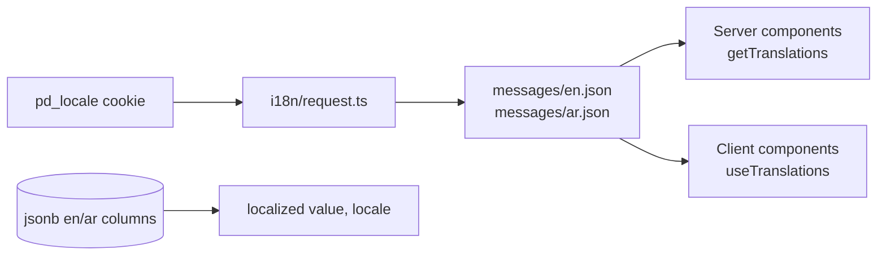

# Languages

PolicyDesk ships in **English** and **Arabic**, with a right-to-left layout for Arabic. The language is a per-user choice stored in a cookie. URLs are the same in every language.

## Three kinds of text

| Kind               | Example                                            | Where it lives                                    |
| ------------------ | -------------------------------------------------- | ------------------------------------------------- |
| Interface text     | "Book policy"                                      | `messages/*.json`                                 |
| Fixed data labels  | product "Car", status "Won", cover "Comprehensive" | Keys in `constants/`, labels in `messages/*.json` |
| Admin-entered data | Plan names, document types                         | `jsonb` columns as `{ en, ar }`                   |

Validation errors are message keys (`validation.required`), so forms show them in the user's language. Server action errors work the same way (`errors.planUnavailable`).

## Adding a string

1. Add the key to **both** `messages/en.json` and `messages/ar.json`.
2. Use `t("section.key")`. Keys may not contain dots, so nest objects instead.

## Adding a language

1. Add it to `LOCALES` in `constants/i18n.ts`, and to `RTL_LOCALES` if it is written right to left.
2. Add `messages/<locale>.json` with every key.
3. Admin forms that save `Localized` values need an input for the new language.
