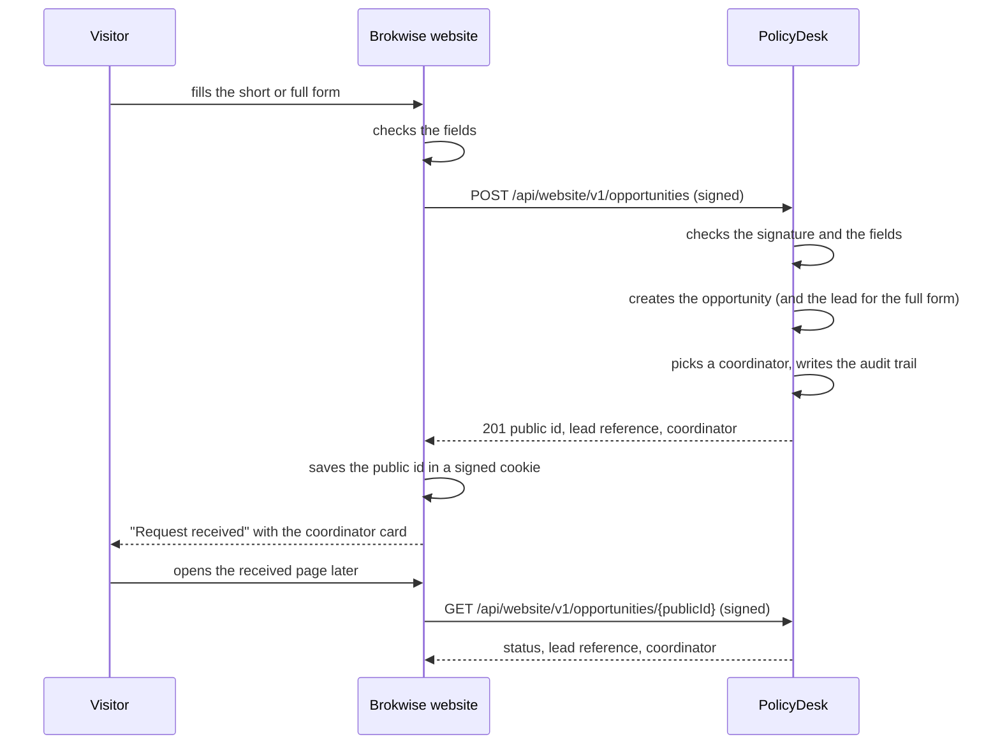

# Website and online payments

The public broker website, **Brokwise**, sends its car forms to PolicyDesk through a small private API. PolicyDesk keeps all the data and the rules; the website stores nothing except a signed cookie that remembers the visitor's journey. Online payments (PaySandbox) arrive in a later step.

> **Demo data:** PolicyDesk's live demo lets anyone sign in as any role, so anything typed on the website is visible to everyone. The website shows "Demo site: use made-up details" next to every form. Never enter real people's data.

## What happens when a visitor sends a form

| Form                                                   | PolicyDesk creates                                                                 | Who is assigned                                |
| ------------------------------------------------------ | ---------------------------------------------------------------------------------- | ---------------------------------------------- |
| **Short form** ("Call me back"): name, contact, car    | An opportunity, status _New_, source _Website_                                     | A coordinator, at once                         |
| **Full form** ("Get prices now"): car, driver, contact | An opportunity, already _Converted_, and its lead (`CAR-…`) with an empty KYC file | A coordinator; the advisor comes after payment |

The car answers (make, model, year and, from the full form, GCC spec, car value, date of birth, nationality, city, years licensed) are shown read-only on the opportunity page under **Car details**. The timeline and the audit log show these steps as done by **Website**.



## Automatic assignment

Website opportunities are never assigned by hand. PolicyDesk picks the coordinator itself:

1. **Who can be picked:** users whose role is **Coordinator** (by role name, not permission), who are active and **available**, in the product's department (car → Motor & Marine).
2. **Fewest open first:** open means their opportunities that are _New_, _Contacted_ or _Qualified_, plus website opportunities already converted whose lead is not yet won or lost.
3. **Tie:** the one who has waited longest since their last automatic assignment (never assigned comes first), then the lowest user number.
4. **Nobody available:** the opportunity stays unassigned and shows "Unassigned"; the website shows its help desk card instead of a person.

Admins switch someone's availability on **Users** with **Set unavailable** / **Set available** (for leave or a full queue). Unavailable people can still sign in. Each switch is in the audit log.

Opportunities from other sources keep the manual assign and convert screens.

## The API

Private and server-to-server only: the visitor's browser never calls it. The route handlers live in `app/api/website/v1/` and only check the signature, check the fields and call `server/website/`, which holds the logic and never imports from the screens.

| Endpoint                                       | Does                                                                                                                         |
| ---------------------------------------------- | ---------------------------------------------------------------------------------------------------------------------------- |
| `POST /api/website/v1/opportunities`           | Body `{ form: "short" \| "full", product: "car", customerName, email, phone, details }`. Returns **201** and the view below. |
| `GET /api/website/v1/opportunities/{publicId}` | Returns **200** and the view, or **404**.                                                                                    |

The view shows only public ids, never internal numbers:

```json
{
  "opportunity": { "publicId": "3f9c2a1e-…", "status": "converted", "product": "car" },
  "lead": { "reference": "CAR-J2M3HX7" },
  "contact": { "role": "coordinator", "name": "Hina Coordinator", "email": "…", "phone": "+923001110001" }
}
```

`lead` is `null` for the short form; `contact` is `null` when nobody was available.

### Signature

Both apps share one secret, `WEBSITE_API_SECRET`. Every request carries two headers:

- `x-brokwise-timestamp`: the time in Unix seconds.
- `x-brokwise-signature`: lowercase hex HMAC-SHA256 of `` `${timestamp}.${METHOD}.${pathAndQuery}.${rawBody}` `` (empty body = empty string).

PolicyDesk refuses a request whose time is more than 5 minutes away from its own, either way (so a captured request can't be replayed later), or whose signature does not match (so a changed body is caught). The compare is constant-time. The code is `server/website/signature.ts`; the website repo has a copy, and both test the same fixed example so they cannot drift apart.

### Errors

Every error has the same body: `{ "error": { "code": "…", "message"?: "…", "field"?: "…" } }`.

| Status | Code              | When                                                                                                                        |
| ------ | ----------------- | --------------------------------------------------------------------------------------------------------------------------- |
| 400    | `invalid_request` | Not JSON, a field fails validation, or an unknown field is sent. `field` names it, e.g. `details.city`. Nothing is written. |
| 401    | `unauthorized`    | Missing, wrong or expired signature                                                                                         |
| 404    | `not_found`       | No opportunity with that public id (also for an id that is not a UUID)                                                      |
| 503    | `api_disabled`    | `WEBSITE_API_SECRET` is not set on this PolicyDesk                                                                          |

Unknown fields are refused, not ignored, so the website can never set things like the coordinator or the status.

### Setting it up

1. Pick a long random secret and set `WEBSITE_API_SECRET` to the same value in PolicyDesk and the website.
2. Point the website's `POLICYDESK_API_URL` at PolicyDesk.
3. Run the migrations (`npm run db:setup`) so opportunities have `public_id` and `details`, and users have `phone`, `available` and `last_assigned_at`.

## Future scope

| Item                                                                                                                                                                   | Why it waits                                                                                                 | Trigger / when                                                                                                       |
| ---------------------------------------------------------------------------------------------------------------------------------------------------------------------- | ------------------------------------------------------------------------------------------------------------ | -------------------------------------------------------------------------------------------------------------------- |
| **Middle API server** (CAPI-style, API-only): website journeys, pricing, orders and payments move out of PolicyDesk's `server/website/` and `server/payments/` into it | One website and one product today; a third app would add a repo, database, deploy and tests for little logic | A second app needs the same API, a real pricing engine arrives, or payments grow (split payments, several merchants) |
| **Online payments** with PaySandbox: plans and add-ons, payment page, paid orders, advisor auto-assignment, an _Online_ payment method                                 | Built step by step                                                                                           | Steps 2–4                                                                                                            |
| **Email OTP verification** before plans are shown                                                                                                                      | Keep the first step basic                                                                                    | After the basic journeys work                                                                                        |
| **Split payments** between sellers (broker vs partner company)                                                                                                         | Needs PaySandbox support                                                                                     | When PaySandbox adds it                                                                                              |
| **In-page card form** instead of the hosted checkout redirect                                                                                                          | Needs PaySandbox support                                                                                     | When PaySandbox adds it                                                                                              |
| **Pricing engine**: price from car value, age, driver, eligibility rules                                                                                               | A flat price plus add-ons is enough for now                                                                  | After step 3                                                                                                         |
| **SEO and content pages**, more products than car                                                                                                                      | Marketing growth                                                                                             | After the car journey is complete                                                                                    |
| **Customer document upload** on the website                                                                                                                            | Coordinators and advisors upload in PolicyDesk first                                                         | Later                                                                                                                |
| **Add-on editing screens** in PolicyDesk                                                                                                                               | Seeded data first                                                                                            | Later                                                                                                                |
| **Automatic reassignment** when a coordinator or advisor does not respond in time                                                                                      | Needs a scheduler (QStash; Vercel Hobby crons run once a day)                                                | Step 6+                                                                                                              |
| **Bot protection and rate limits** (Turnstile, per-IP limits)                                                                                                          | Hardening after the journeys work                                                                            | Step 5                                                                                                               |
| **Clean-up of old demo submissions**                                                                                                                                   | The live demo is open to anyone                                                                              | Later                                                                                                                |
