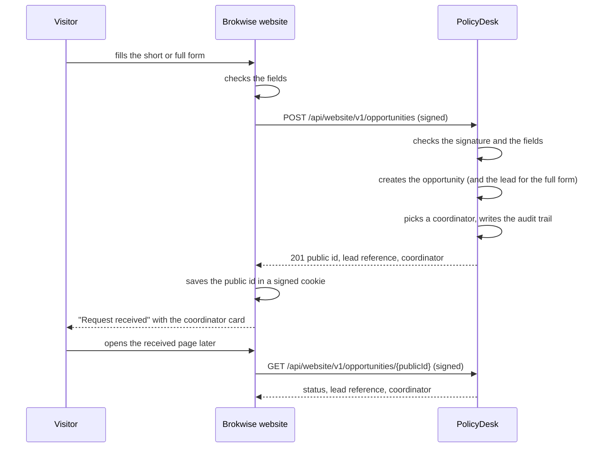
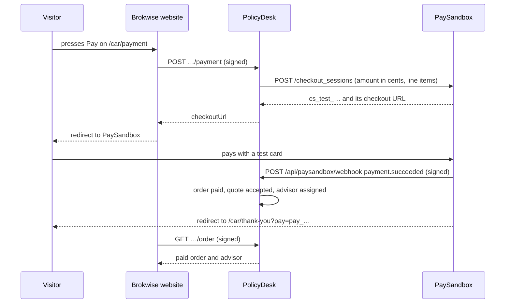
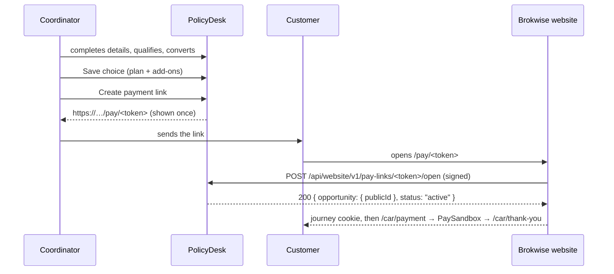

# Website and online payments

The public broker website, **Brokwise**, sends its forms for **car, travel, home and health** to PolicyDesk through a small private API. PolicyDesk keeps all the data and the rules; the website stores nothing except a signed cookie that remembers the visitor's journey. After the full form the visitor picks a plan and its add-ons, which PolicyDesk saves on the lead as a quote, and pays for it on PaySandbox's hosted checkout. PolicyDesk then records the paid order, accepts the quote and assigns an advisor. After the short form the coordinator does those steps with the customer on the phone and sends a private **payment link**; the customer pays through the same pages (see Assisted flow).

> **Demo data:** PolicyDesk's live demo lets anyone sign in as any role, so anything typed on the website is visible to everyone. The website shows "Demo site: use made-up details" next to every form. Never enter real people's data.

## What happens when a visitor sends a form

| Form                                                                         | PolicyDesk creates                                                                                            | Who is assigned                                |
| ---------------------------------------------------------------------------- | ------------------------------------------------------------------------------------------------------------- | ---------------------------------------------- |
| **Short form** ("Call me back"): name, contact, the product's quick question | An opportunity, status _New_, source _Website_                                                                | A coordinator, at once                         |
| **Full form** ("Get prices now"): the product's fields, contact              | An opportunity, already _Converted_, and its lead (`CAR-…`, `TRV-…`, `HOM-…`, `HLT-…`) with an empty KYC file | A coordinator; the advisor comes after payment |

The answers are shown on the opportunity page under **Car details**, **Travel details** and so on, in the form's order and with translated choices: read-only once converted, and as a form the coordinator completes while a short-form opportunity is still open. The timeline and the audit log show these steps as done by **Website**.

## Products the website sells

The website sells four products (`constants/website.ts`). Each has its own details schema in `schemas/website.ts`: the quick form sends only its first field(s), the full form sends them all. Every request is checked against the chosen product's schema, so a product the website doesn't sell (`bike`, `life`…) is refused on `product`, and a field of another product (`make` on travel) or a missing one is refused on `details.<field>`. Nothing is written.

| Product  | Department     | Quick form                                                                      | Full form adds                                                                                                                                                                      |
| -------- | -------------- | ------------------------------------------------------------------------------- | ----------------------------------------------------------------------------------------------------------------------------------------------------------------------------------- |
| `car`    | Motor & Marine | `make`, `model`, `year`                                                         | `gccSpec` (yes/no), `carValue`, `dateOfBirth` (driver 18 to 80), `nationality`, `city`, `yearsLicensed`                                                                             |
| `travel` | Home & Travel  | `destination`: `gcc`, `asia`, `europe_schengen`, `worldwide_ex_us`, `worldwide` | `tripType` (`single`, `annual`), `startDate` (today or later), `endDate` (single trips only, on or after the start, at most 180 days), `travellers` (1 to 9), `oldestAge` (0 to 85) |
| `home`   | Home & Travel  | `city`                                                                          | `propertyType` (`apartment`, `villa`, `townhouse`), `occupancy` (`owner`, `tenant`), `buildingValue` (owners only, $10,000 to $5,000,000), `contentsValue` ($1,000 to $500,000)     |
| `health` | Health         | `coverFor`: `me`, `me_spouse`, `family`                                         | `children` (0 to 6, family only), `dateOfBirth` (18 to 75), `city`, `preExisting` (yes/no)                                                                                          |

Rules across fields give their own message on the field: `validation.startInPast`, `validation.endBeforeStart`, `validation.tripTooLong`, `validation.annualNoEndDate` (an annual trip has no end date), `validation.ownersOnly` (a tenant sends no building value), `validation.familyOnly` (children only on family cover), `validation.age` / `validation.ageHealth`. Dates are ISO days compared with today in UTC. A new line adds a schema, a field list and add-ons, not tables.



## Automatic assignment

Website opportunities are never assigned by hand. PolicyDesk picks the coordinator itself:

1. **Who can be picked:** users whose role is **Coordinator** (by role name, not permission), who are active and **available**, in the product's department (car → Motor & Marine, travel and home → Home & Travel, health → Health).
2. **Fewest open first:** open means their opportunities that are _New_, _Contacted_ or _Qualified_, plus website opportunities already converted whose lead is not yet won or lost.
3. **Tie:** the one who has waited longest since their last automatic assignment (never assigned comes first), then the lowest user number.
4. **Nobody available:** the opportunity stays unassigned and shows "Unassigned"; the website shows its help desk card instead of a person.

Admins switch someone's availability on **Users** with **Set unavailable** / **Set available** (for leave or a full queue). Unavailable people can still sign in. Each switch is in the audit log.

**Advisors** are picked the same way when a website lead's payment succeeds: role **Advisor**, active and available, same department, fewest open leads (assigned to them and not won or lost), then longest wait, then lowest number. The lead's timeline shows _Website assigned the advisor_ with the name, or "No advisor available", in which case the lead stays unassigned until a manager assigns one. A lead that already has an advisor keeps them.

Opportunities from other sources, and ones marked _Website_ by hand for products the website doesn't sell (bike, life…), keep the manual assign and convert screens.

## Plans and add-ons

Only visitors who sent the **full form** see plans, because the choice is saved on their lead. Short-form visitors stay with their coordinator.

The website shows every active plan of the lead's product from an active insurer, cheapest first; plans and add-ons of another product never appear, and picking one is refused. Each plan has its own add-ons, of three kinds:

| Kind            | On the plans page              | Price                     |
| --------------- | ------------------------------ | ------------------------- |
| **Included**    | Always on, shown as "Included" | 0                         |
| **Optional**    | A checkbox, not ticked         | Its price when ticked     |
| **Preselected** | A checkbox, ticked; may untick | Its price unless unticked |

**Total = the plan's base premium + the price of every ticked optional or preselected add-on.** Prices are yearly, in whole US dollars, with no tax line. The website sends only the plan id and the ticked add-on ids; PolicyDesk works out every price itself (`server/website/pricing.ts`), so a changed price in the browser cannot reach a quote. An add-on id that is included, belongs to another plan, is switched off, is sent twice or does not exist is refused, and nothing is saved.

**One open website selection per lead.** The first choice adds a quote to the lead (next number, e.g. `CAR-J2M3HX7-Q1`) and moves a lead in _Needs analysis_ to _Quoted_. Choosing again updates that same quote (same reference) for as long as it is still _Sent_. The quote keeps a copy of the plan and add-ons, like quotes made by advisors.

On the lead's **Quotes** tab, each quote lists its add-ons under the plan: "Included" or the price. Quotes made by the website show **Website** as their creator, and the timeline shows each choice as _Website picked a plan_ with the insurer, plan and total.

Add-ons are seeded data for now (no editing screen; catalogue in `constants/add-ons.ts`, kinds in `server/website/catalogue.ts`). Each product's plans get a fixed set by cover (yearly USD):

- **Car, third party:** roadside assistance, driver accident and passenger accident, all optional.
- **Car, comprehensive:** roadside assistance included; driver accident preselected; replacement car, windscreen and passenger accident optional; regional cover optional on some plans.
- **Car, agency repair:** as comprehensive, with replacement car included.
- **Travel:** trip cancellation $25 (optional; included on annual multi-trip), baggage delay $10 (preselected), adventure sports $30 and COVID-19 cover $15 (optional).
- **Home:** accidental damage $40 and valuables away from home $35 (optional), alternative accommodation $25 (included on building and contents, otherwise optional), domestic helper cover $20 (preselected).
- **Health:** dental $90, optical $60 and maternity $150 (optional); a wellness check-up included on every plan.

## Online payments

The visitor pays on **PaySandbox**, a test-mode payment gateway: no real money moves. Only PolicyDesk talks to PaySandbox (`server/payments/`); the website asks PolicyDesk for a checkout link and sends the visitor there.



**Orders.** Pressing Pay creates an **order** on the lead for the saved website quote: status _Pending_, the total in whole dollars and the line items, and the PaySandbox checkout session (`cs_test_…`, its URL and expiry, 24 hours). PaySandbox has no metadata field, so PolicyDesk matches payments to orders by the session id.

- **Line items:** the plan with its insurer ("Northwind Assurance Northwind Plus"), each included add-on at 0, then each ticked add-on. They add up to the quote's premium. No tax line. PaySandbox gets every amount × 100 (cents), with no currency, so the project's own (USD) is used.
- **Pay again:** while the order's session is still open and the selection has not changed, Pay sends the visitor back to the same session. If the session was paid in the meantime, the answer is `already_paid`.
- **Changed selection:** a different plan or add-ons means a new total, so the pending order is marked _Expired_ and a new order and session are made. A payment that still arrives on the old session is recorded on its own (expired) order and audited, but it does not accept the quote, so the newer selection stays open; the advisor sorts out the difference.
- **Paid twice is impossible from the website:** once a lead has a paid order, starting a payment answers `already_paid`.

**When PaySandbox confirms** (`payment.succeeded`), in this order, once:

1. The order becomes _Paid_ with the PaySandbox payment id (`pay_…`) and the time.
2. The quote becomes _Accepted_. The lead stays _Quoted_: no policy is booked yet.
3. An advisor is assigned (see Automatic assignment).
4. The lead's timeline shows _Website paid online_ (amount and `pay_…`), _Website marked a quote accepted_ and _Website assigned the advisor_.

The advisor then does KYC and documents as usual and books the policy. **Booking sees the paid order** (same quote and amount) and creates the policy already **Active** and **Paid**, method **Online (PaySandbox)**, reference `pay_…`, paid on the order's date. Finance has nothing to record. The lead's **Policy** tab shows an **Online payment** panel (status, amount, PaySandbox payment id, paid on) whenever the lead has an order.

**Webhook.** `POST /api/paysandbox/webhook`, called by PaySandbox only. It is signed the [Standard Webhooks](https://www.standardwebhooks.com/) way: headers `webhook-id` (the event id), `webhook-timestamp` and `webhook-signature`, made with the endpoint's `whsec_…` secret over the raw body. PolicyDesk checks it with the `standardwebhooks` library before reading the body as JSON.

| Case                                                          | Answer                                                                    |
| ------------------------------------------------------------- | ------------------------------------------------------------------------- |
| Wrong or missing signature, or timestamp more than 5 min away | **401**, nothing written                                                  |
| A `webhook-id` already handled (a retry or a replay)          | **200** `{ received: true, duplicate: true }`, nothing changes            |
| `payment.succeeded` for a known session                       | **200**, the order is paid (once; a paid order is left as it is)          |
| `payment.failed` for a known session                          | **200**, _had an online payment declined_ on the timeline with the reason |
| Any other event, or a session PolicyDesk did not create       | **200**, ignored                                                          |
| `PAYSANDBOX_WEBHOOK_SECRET` not set                           | **503**                                                                   |
| PolicyDesk fails while handling it                            | **500**, and the id is forgotten so PaySandbox's retry is handled         |

**Late webhook.** If the visitor is back on the thank-you page before the webhook, reading the order (`GET …/order`) asks PaySandbox about the pending order's session. When the session is complete and its payment succeeded, PolicyDesk records the payment there and then, exactly as the webhook would; the webhook that follows is then a no-op. If PaySandbox cannot be reached, the order stays pending and the webhook settles it.

## Assisted flow (short form, pay later)

The short-form visitor never sees plans on the website. Their coordinator does everything before payment on the **opportunity page**; the advisor still comes after payment.

1. **Details.** While the opportunity is open, the **Car details** (or Travel, Home, Health) panel is a form with the product's full-form fields, built from its field list in `constants/website.ts`. Fields may stay empty; **Save details** keeps the rest of the details and writes _details_ to the audit log with the fields that changed. The same rules as the website apply (ages, ranges, trip dates, owners only, family only).
2. **Qualify**, then **Convert to lead.** There is no advisor picker: "The advisor is assigned automatically after the customer pays." Convert checks the saved details against the full form and, if one is missing, says which: "Complete GCC spec before converting" (the first missing field, in the form's order); a broken rule across fields gives its own message, e.g. a trip that has already started. It then creates the lead (`CAR-…`, `TRV-…`…) with an empty KYC file and no advisor, marks the opportunity _Converted_ and logs _convert_ with "advisor after payment". The page stays on the opportunity.
3. **Online payment** panel (after convert). The coordinator picks a plan (active plans of the product, cheapest first) and ticks add-ons with the customer: included ones are shown ticked and locked, preselected ones come ticked, and the page shows the yearly total. **Save choice** prices it exactly like the website's selection and saves it as the lead's **online quote** (one per lead; saving again updates it), with the coordinator as its creator.
4. **Create payment link** shows the link once, with a **Copy** button: "Shown once. Create a new link if it's lost." The coordinator sends it to the customer themselves (PolicyDesk sends no email or SMS).
5. The customer opens `https://brokwise.vercel.app/pay/<token>`. The website asks PolicyDesk to open the link, remembers the opportunity in its journey cookie and sends the customer to its payment page, PaySandbox and the thank-you page, exactly as in the self-serve flow. Payment accepts the online quote and assigns the advisor.

Only roles with **Convert opportunities** (Coordinator, Department manager, Admin) see the forms, and only for opportunities in their scope; anyone else gets 404, as for any opportunity.

**Online quotes.** A quote is the customer's online choice when its `online` flag is set: the website's choice or the coordinator's. Payment, the website's selection and the order always use the lead's open (_Sent_) online quote. The migration marks every quote made before by the website (no creator) as online.

### Payment links

| Rule           | What it means                                                                                                                          |
| -------------- | -------------------------------------------------------------------------------------------------------------------------------------- |
| Token          | 32 random bytes, base64url (43 characters). Only its SHA-256 hash is stored, so the database never holds a working link.               |
| Shown once     | The URL appears right after **Create payment link** and never again. A lost link is replaced, not recovered.                           |
| 72 hours       | A link works for 72 hours from when it was made.                                                                                       |
| One at once    | Making a link revokes the lead's other links. **Revoke** (with a confirm) stops one by hand.                                           |
| Latest plan    | A link points at the lead, not at a price: if the coordinator changes the choice later, the payment page shows the new plan and total. |
| Dead once paid | Once the lead's order is paid, opening a link sends the customer to the thank-you page; nothing more can be paid.                      |

The panel lists every link of the lead: created (and by whom), expires, first opened, and status **Active**, **Expired**, **Revoked** or **Paid** (revoked wins over paid, so an old link gives nothing away). Below it, the order's status from the self-serve flow. The lead's timeline shows _created a payment link_ (with its expiry), _revoked a payment link_ and _Website opened the payment link_ (first open only).



## The API

Private and server-to-server only: the visitor's browser never calls it. The route handlers live in `app/api/website/v1/` and only check the signature, check the fields and call `server/website/`, which holds the logic and never imports from the screens.

| Endpoint                                                 | Does                                                                                                                                                                                                                                                                |
| -------------------------------------------------------- | ------------------------------------------------------------------------------------------------------------------------------------------------------------------------------------------------------------------------------------------------------------------- |
| `POST /api/website/v1/opportunities`                     | Body `{ form: "short" \| "full", product: "car" \| "travel" \| "home" \| "health", customerName, email, phone, details }` (details per product above). Returns **201** and the view below.                                                                          |
| `GET /api/website/v1/opportunities/{publicId}`           | Returns **200** and the view, or **404**.                                                                                                                                                                                                                           |
| `GET /api/website/v1/opportunities/{publicId}/plans`     | Returns **200** `{ plans }`: active plans of the opportunity's product, cheapest first, each with insurer, name, cover, excess, base premium, benefits and add-ons (id, name, kind, price). **409** `no_lead` for a short-form opportunity.                         |
| `PUT /api/website/v1/opportunities/{publicId}/selection` | Body `{ planId, addOnIds }` (ticked optional and preselected add-ons, at most 20). Prices and saves the choice; returns **200** `{ selection }`.                                                                                                                    |
| `GET /api/website/v1/opportunities/{publicId}/payment`   | Returns **200** `{ payment: { status: "ready" \| "already_paid", lines: [{ label, amount }], total, quoteReference } }`. **409** `no_lead` or `no_selection`.                                                                                                       |
| `POST /api/website/v1/opportunities/{publicId}/payment`  | Body `{}`. Returns **200** `{ checkoutUrl }` (a new or the reused PaySandbox session). **409** `already_paid` or `no_selection`, **502**, **503** (below).                                                                                                          |
| `GET /api/website/v1/opportunities/{publicId}/order`     | Returns **200** `{ order, advisor }` for the thank-you page (below). `order` is `null` before Pay is pressed (or for the short form).                                                                                                                               |
| `POST /api/website/v1/pay-links/{token}/open`            | Empty body (or `{}`). Returns **200** `{ opportunity: { publicId }, status: "active" \| "paid" }`; **404** `not_found` for an unknown, malformed or revoked token (same answer for each); **410** `link_expired`. The first successful open is stamped and audited. |

The view shows only public ids, never internal numbers:

```json
{
  "opportunity": { "publicId": "3f9c2a1e-…", "status": "converted", "product": "car" },
  "lead": { "reference": "CAR-J2M3HX7" },
  "contact": { "role": "coordinator", "name": "Hina Malik", "email": "…", "phone": "+923001110001" }
}
```

`lead` is `null` for the short form; `contact` is `null` when nobody was available. Once a plan is chosen, the view also has `selection` (otherwise `null`):

```json
{
  "quoteReference": "CAR-J2M3HX7-Q1",
  "planId": 2,
  "insurer": "Northwind Assurance",
  "planName": "Northwind Plus",
  "cover": "comprehensive",
  "coverLabel": "Comprehensive",
  "lines": [
    { "label": "Northwind Plus", "kind": "plan", "amount": 1110 },
    { "label": "Roadside assistance", "kind": "included", "amount": 0 },
    { "label": "Replacement car", "kind": "optional", "amount": 60 }
  ],
  "total": 1170,
  "addOnIds": [5]
}
```

The `PUT …/selection` answer has the same shape. `addOnIds` lists the ticked add-ons so the website can tick them again. Once the website quote is paid and accepted, `selection` is `null` again.

The order view shows only masked contact details:

```json
{
  "order": {
    "status": "paid",
    "lines": [
      { "label": "Northwind Assurance Northwind Plus", "amount": 1110 },
      { "label": "Roadside assistance", "amount": 0 },
      { "label": "Replacement car", "amount": 60 }
    ],
    "total": 1170,
    "paidAt": "2026-11-12T09:30:00.000Z",
    "paymentId": "pay_…",
    "quoteReference": "CAR-J2M3HX7-Q1",
    "emailMasked": "b***s@yopmail.com",
    "phoneMasked": "+92 *** ***4568"
  },
  "advisor": { "role": "advisor", "name": "Aisha Khan", "email": "…", "phone": "+923001110002" }
}
```

`order.status` is `pending` until PaySandbox confirms (the read re-checks first, see Late webhook) and `paid` after; `advisor` is `null` until someone is assigned.

### Signature

Both apps share one secret, `WEBSITE_API_SECRET`. Every request carries two headers:

- `x-brokwise-timestamp`: the time in Unix seconds.
- `x-brokwise-signature`: lowercase hex HMAC-SHA256 of `` `${timestamp}.${METHOD}.${pathAndQuery}.${rawBody}` `` (empty body = empty string).

PolicyDesk refuses a request whose time is more than 5 minutes away from its own, either way (so a captured request can't be replayed later), or whose signature does not match (so a changed body is caught). The compare is constant-time. The code is `server/website/signature.ts`; the website repo has a copy, and both test the same fixed example so they cannot drift apart.

### Errors

Every error has the same body: `{ "error": { "code": "…", "message"?: "…", "field"?: "…" } }`.

| Status | Code                     | When                                                                                                                                                                   |
| ------ | ------------------------ | ---------------------------------------------------------------------------------------------------------------------------------------------------------------------- |
| 400    | `invalid_request`        | Not JSON, a field fails validation, or an unknown field is sent. `field` names it, e.g. `details.city`. Nothing is written.                                            |
| 400    | `invalid_request`        | Selection only: `field: "planId"` for a plan that is unknown, switched off or of another product; `field: "addOnIds"` for an add-on that cannot be ticked on that plan |
| 401    | `unauthorized`           | Missing, wrong or expired signature                                                                                                                                    |
| 404    | `not_found`              | No opportunity with that public id (also for an id that is not a UUID)                                                                                                 |
| 409    | `no_lead`                | Plans, selection or payment for a short-form opportunity, which has no lead                                                                                            |
| 409    | `no_selection`           | Payment before a plan was picked                                                                                                                                       |
| 409    | `already_paid`           | Starting a payment for a lead that is already paid                                                                                                                     |
| 410    | `link_expired`           | Opening a payment link more than 72 hours old; the customer asks their coordinator for a new one                                                                       |
| 429    | `rate_limited`           | The visitor's IP used up its hourly limit for that kind of call (see Rate limits); the header `Retry-After` gives the seconds until the next hour. Nothing is done     |
| 502    | `paysandbox_unavailable` | PaySandbox could not be reached or refused the checkout; nothing is charged, try again                                                                                 |
| 503    | `api_disabled`           | `WEBSITE_API_SECRET` is not set on this PolicyDesk                                                                                                                     |
| 503    | `payments_disabled`      | Starting a payment while `PAYSANDBOX_SECRET_KEY` or `WEBSITE_URL` is not set                                                                                           |

Unknown fields are refused, not ignored, so the website can never set things like the coordinator or the status.

### Rate limits

The website sends each visitor's IP in the header `x-brokwise-client-ip`. PolicyDesk counts calls per IP and kind of call in fixed UTC-hour windows, in the `rate_limits` table (`server/website/rate-limit.ts`). Past the limit it answers **429** `rate_limited` with `Retry-After` and does nothing else; the count starts again at the next full hour.

| Group    | Calls                                            | Env                              | Default per hour |
| -------- | ------------------------------------------------ | -------------------------------- | ---------------- |
| `lead`   | `POST /opportunities`                            | `RATE_LIMIT_LEADS_PER_HOUR`      | 5                |
| `select` | `PUT …/selection`                                | `RATE_LIMIT_SELECTIONS_PER_HOUR` | 30               |
| `pay`    | `POST …/payment`                                 | `RATE_LIMIT_PAYMENTS_PER_HOUR`   | 20               |
| `link`   | `POST /pay-links/{token}/open`                   | `RATE_LIMIT_LINK_OPENS_PER_HOUR` | 20               |
| `read`   | Every `GET` (opportunity, plans, payment, order) | `RATE_LIMIT_READS_PER_HOUR`      | 600              |

- The signature is checked first, so unsigned or wrongly signed calls get **401** and are never counted.
- The IP header is not signed separately: only holders of the API secret can call at all. A missing header, or one that is not a single IPv4 or IPv6 address, counts against one shared `unknown` bucket.
- Unknown pay-link tokens count too, so tokens cannot be guessed faster than the `link` limit.
- `RATE_LIMITS=off` turns all limits off (the website's own E2E tests use it, since all their calls come from one IP). An env value that is not a positive whole number keeps the default.
- The PaySandbox webhook is never limited.
- Windows older than a day are deleted on about 1 call in 50, so the table stays small without a scheduled job.

### Setting it up

1. Pick a long random secret and set `WEBSITE_API_SECRET` to the same value in PolicyDesk and the website.
2. Point the website's `POLICYDESK_API_URL` at PolicyDesk.
3. Run the migrations (`npm run db:setup`) so opportunities have `public_id` and `details`, users have `phone`, `available` and `last_assigned_at`, plans have add-ons (`plan_add_ons`), quotes keep theirs (`add_ons`), the `orders`, `webhook_events`, `payment_links` and `rate_limits` tables exist, and quotes have `online` (set for the website's existing quotes).
4. The same command gives every active plan of a website product **without** add-ons its default set and prints `Add-ons added: N`. On the live database it adds the travel, home and health add-ons (car plans already have theirs), and migration `0006` gives the health and home & travel coordinators and advisors their made-up phones. It runs on databases that already have data too, and plans that have add-ons are skipped, so running it again adds nothing. Nothing runs during a build: previews and production share one database.

### Setting up PaySandbox

1. On PaySandbox, create a project whose currency is **USD** (PolicyDesk's currency; checkouts leave the currency out, so the project's is used).
2. Copy its secret key (`sk_test_…`) into PolicyDesk's `PAYSANDBOX_SECRET_KEY`.
3. Add a webhook endpoint `https://<policydesk>/api/paysandbox/webhook` for all payment events, and copy its signing secret (`whsec_…`) into `PAYSANDBOX_WEBHOOK_SECRET`.
4. Set `WEBSITE_URL` to the website's address (e.g. `https://brokwise.vercel.app`): PaySandbox sends the visitor back to `/<product>/thank-you` after paying and to `/<product>/payment` on cancel (`/car/…`, `/travel/…`, `/home/…`, `/health/…`).
5. `PAYSANDBOX_API_URL` defaults to `https://paysandbox.vercel.app/api/v1`; the E2E tests point it at a fake (`e2e/fake-paysandbox.mjs`).

PaySandbox's free merchant allows 200 checkout sessions and 1,000 API requests a day; a session expires after 24 hours and amounts are $1 to $5,000.

## Future scope

| Item                                                                                                                                                                   | Why it waits                                                                                                 | Trigger / when                                                                                                       |
| ---------------------------------------------------------------------------------------------------------------------------------------------------------------------- | ------------------------------------------------------------------------------------------------------------ | -------------------------------------------------------------------------------------------------------------------- |
| **Middle API server** (CAPI-style, API-only): website journeys, pricing, orders and payments move out of PolicyDesk's `server/website/` and `server/payments/` into it | One website and one product today; a third app would add a repo, database, deploy and tests for little logic | A second app needs the same API, a real pricing engine arrives, or payments grow (split payments, several merchants) |
| **Refunds** through PaySandbox, cancelling the policy if one was booked                                                                                                | Needs a refund screen and rules for partly used cover                                                        | Later                                                                                                                |
| **Email OTP verification** before plans are shown                                                                                                                      | Keep the first step basic                                                                                    | After the basic journeys work                                                                                        |
| **Split payments** between sellers (broker vs partner company)                                                                                                         | Needs PaySandbox support                                                                                     | When PaySandbox adds it                                                                                              |
| **In-page card form** instead of the hosted checkout redirect                                                                                                          | Needs PaySandbox support                                                                                     | When PaySandbox adds it                                                                                              |
| **Pricing engine**: price from car value, age, driver, eligibility rules                                                                                               | A flat price plus add-ons is enough for now                                                                  | After step 3                                                                                                         |
| **SEO and content pages**, business lines                                                                                                                              | Marketing growth                                                                                             | After the four personal lines are live                                                                               |
| **Customer document upload** on the website                                                                                                                            | Coordinators and advisors upload in PolicyDesk first                                                         | Later                                                                                                                |
| **Add-on editing screens** in PolicyDesk                                                                                                                               | Seeded data first                                                                                            | Later                                                                                                                |
| **Sending payment links** by email or SMS from PolicyDesk                                                                                                              | Coordinators copy the link into their own channel for now                                                    | Later                                                                                                                |
| **Automatic reassignment** when a coordinator or advisor does not respond in time                                                                                      | Needs a scheduler (QStash; Vercel Hobby crons run once a day)                                                | Step 6+                                                                                                              |
| **Bot protection and rate limits** (Turnstile, per-IP limits)                                                                                                          | Hardening after the journeys work                                                                            | Step 5                                                                                                               |
| **Clean-up of old demo submissions**                                                                                                                                   | The live demo is open to anyone                                                                              | Later                                                                                                                |
