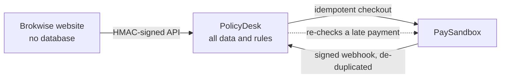

# Engineering highlights: website and online payments

PolicyDesk is the back office for **Brokwise**, a made-up broker's public website, and takes payment
through **PaySandbox**, a test payment gateway. This page lists the decisions in that work that go
beyond "it works", and where each one is tested. The flows themselves are in
[Website and online payments](09-website-and-online-payments.md).

## Boundaries

- **One source of truth.** The website stores nothing; every rule (statuses, scopes, pricing,
  audit) runs here. The API is a written, narrow exception to the "no API routes" rule in
  [the coding standard](/kb/coding-standard): only `/api/website/v1/*` and `/api/paysandbox/webhook`.
- **Liftable later.** Website and payment logic lives in `server/website/` and `server/payments/`,
  which never import screens, so it can move into a separate API service without a rewrite.
- **Multi-product by design.** Every call names the product; product fields live in one validated
  `details` column, so a new line of business is a schema, not a migration of tables (see
  Config-driven products).

## Config-driven products

- **Four lines, one engine.** Car, travel, home and health share every table, endpoint and screen.
  A product is a list entry (`constants/website.ts`), a details schema with its full-form fields and
  rules across fields (`schemas/website.ts`), a field list for the coordinator's form and an add-on
  catalogue. Adding the three lines needed no new table, only a data migration for phones.
- **Refused, not ignored.** The request is a discriminated union on `product` with strict objects,
  so a product the website doesn't sell, or another product's field, is a 400 naming the field.
- **One rule set, three places.** The same per-product rules check the website's request, the
  coordinator's form (in the browser and in the action) and the convert check, so a trip that ends
  before it starts or a tenant's building value is caught everywhere (unit tests in
  `schemas/website.test.ts`).
- **One form for every line.** The coordinator's details form and the details panel are built from
  the product's field list, so a new line gets its screens without a new component.
- **Departments from the product map.** Leads and advisors-after-payment route through the existing
  product → department mapping (travel and home → Home & Travel, health → Health), and PaySandbox
  returns the visitor to the product's own pages.

## Security

- **Signed requests:** HMAC-SHA256 over timestamp, method, path and raw body, 5-minute window,
  constant-time comparison; the website and PolicyDesk test the same fixed vector.
- **Strict input:** unknown fields are rejected and named; bodies are size-capped.
- **Server-side prices:** the website sends ids; tampered or foreign add-on ids are refused.
- **Payment links:** 256-bit tokens kept only as SHA-256 hashes, shown once, valid 72 hours,
  revoked by the next link; unknown and revoked links get the same 404.
- **Rate limits:** per visitor IP and endpoint group, one upsert per call, signature checked first
  so spam can't fill the table, `Retry-After` on 429, webhook exempt, tunable by env.

## Payments

- **Idempotent checkout** with a per-order key; pressing Pay again reuses the open session.
- **Webhooks** verified with Standard Webhooks and handled once per `webhook-id`; a failed handler
  releases the id so the gateway's retry is processed.
- **Late webhook?** Reading the order re-checks the session at the gateway and settles it.
- **Old checkout paid after the customer changed plan:** recorded and audited on its own order,
  never overwrites the newer choice; booking only applies a paid order whose amount matches.
- **Declines are recorded** with their code on the lead timeline.

## Rules kept intact

- Automatic assignment (coordinator on arrival, advisor after payment): available people of the
  right role in the department, fewest open records, then longest waiting, with the reason on the
  timeline.
- Online payment does not skip compliance: KYC (with the four-eyes rule) and documents still gate
  booking; booking then marks the policy paid "Online (PaySandbox)".
- Quotes keep snapshots of the plan and add-ons, so history never changes.
- Every website and system action is on the audit trail with "Website" as the actor.

## Delivery

- Additive migrations, run before each merge, so live code never meets a missing column.
- Data fixes run in `db:setup` and are idempotent: they pick out only the wrong rows (e.g. plans that
  list another product's benefits) and fix them the same way every time, so running it twice is safe
  (unit tests in `server/website/benefits.test.ts`).
- Preview deployments share the production database, so no migration runs during a build.
- A fake PaySandbox (`e2e/fake-paysandbox.mjs`) lets the full payment flow, including a webhook that
  never arrives, run in tests without the live gateway.
- Tests: 67 unit tests for this work (signing, pricing, assignment, pay links, rate limits on real
  SQL, per-product details rules) and 59 end-to-end tests in specs 06–11.
