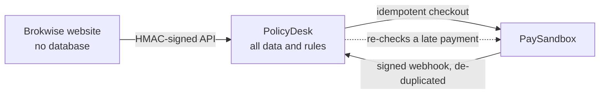

# Engineering highlights: website and online payments

PolicyDesk is the back office for **Brokwise**, a made-up broker's public website, and takes payment
through **PaySandbox**, a test payment gateway. This page lists the decisions in that work that go
beyond "it works", and where each one is tested. The flows themselves are in
[Website and online payments](09-website-and-online-payments.md).

## Boundaries

- **One source of truth.** The website stores nothing; every rule (statuses, scopes, pricing,
  audit) runs here. The API is a written, narrow exception to the "no API routes" rule in
  [the coding standard](/kb/coding-standard): only `/api/website/v1/*` and `/api/paysandbox/webhook`.
- **Liftable later.** Website and payment logic lives in `server/website/` and `server/payments/`,
  which never import screens, so it can move into a separate API service without a rewrite.
- **Multi-product by design.** Every call names the product; product fields live in one validated
  `details` column, so a new line of business is a schema, not a migration of tables.

## Security

- **Signed requests:** HMAC-SHA256 over timestamp, method, path and raw body, 5-minute window,
  constant-time comparison; the website and PolicyDesk test the same fixed vector.
- **Strict input:** unknown fields are rejected and named; bodies are size-capped.
- **Server-side prices:** the website sends ids; tampered or foreign add-on ids are refused.
- **Payment links:** 256-bit tokens kept only as SHA-256 hashes, shown once, valid 72 hours,
  revoked by the next link; unknown and revoked links get the same 404.
- **Rate limits:** per visitor IP and endpoint group, one upsert per call, signature checked first
  so spam can't fill the table, `Retry-After` on 429, webhook exempt, tunable by env.

## Payments

- **Idempotent checkout** with a per-order key; pressing Pay again reuses the open session.
- **Webhooks** verified with Standard Webhooks and handled once per `webhook-id`; a failed handler
  releases the id so the gateway's retry is processed.
- **Late webhook?** Reading the order re-checks the session at the gateway and settles it.
- **Old checkout paid after the customer changed plan:** recorded and audited on its own order,
  never overwrites the newer choice; booking only applies a paid order whose amount matches.
- **Declines are recorded** with their code on the lead timeline.

## Rules kept intact

- Automatic assignment (coordinator on arrival, advisor after payment): available people of the
  right role in the department, fewest open records, then longest waiting, with the reason on the
  timeline.
- Online payment does not skip compliance: KYC (with the four-eyes rule) and documents still gate
  booking; booking then marks the policy paid "Online (PaySandbox)".
- Quotes keep snapshots of the plan and add-ons, so history never changes.
- Every website and system action is on the audit trail with "Website" as the actor.

## Delivery

- Additive migrations, run before each merge, so live code never meets a missing column.
- Preview deployments share the production database, so no migration runs during a build.
- A fake PaySandbox (`e2e/fake-paysandbox.mjs`) lets the full payment flow, including a webhook that
  never arrives, run in tests without the live gateway.
- Tests: 46 unit tests for this work (signing, pricing, assignment, pay links, rate limits on real
  SQL) and 47 end-to-end tests in specs 06–10.
